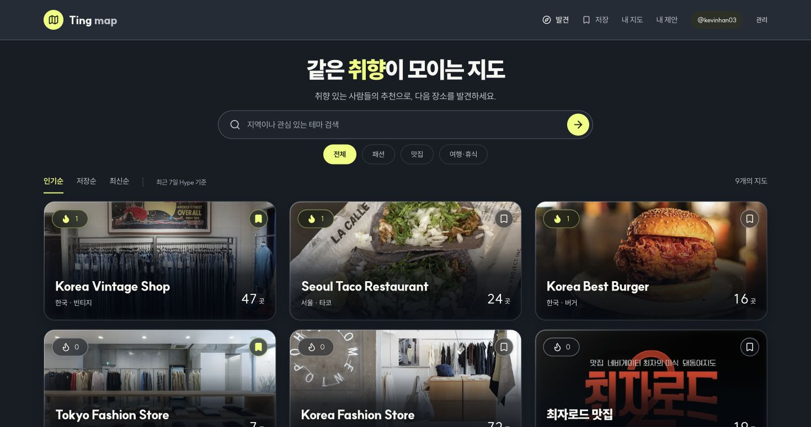
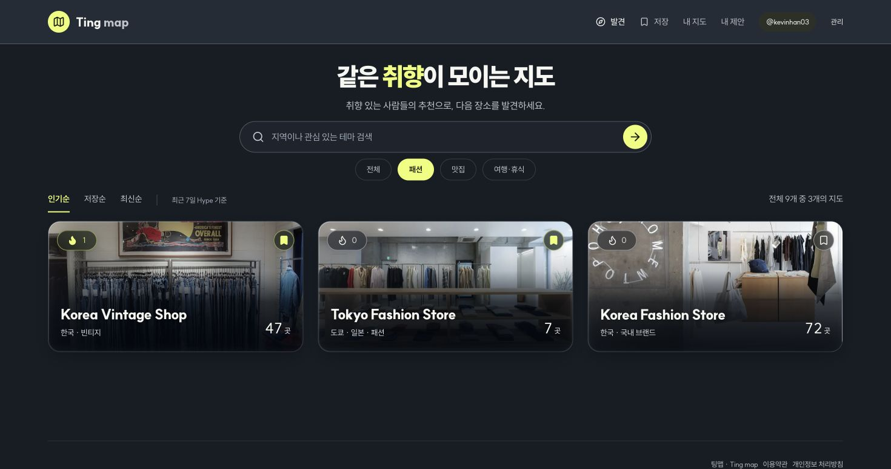
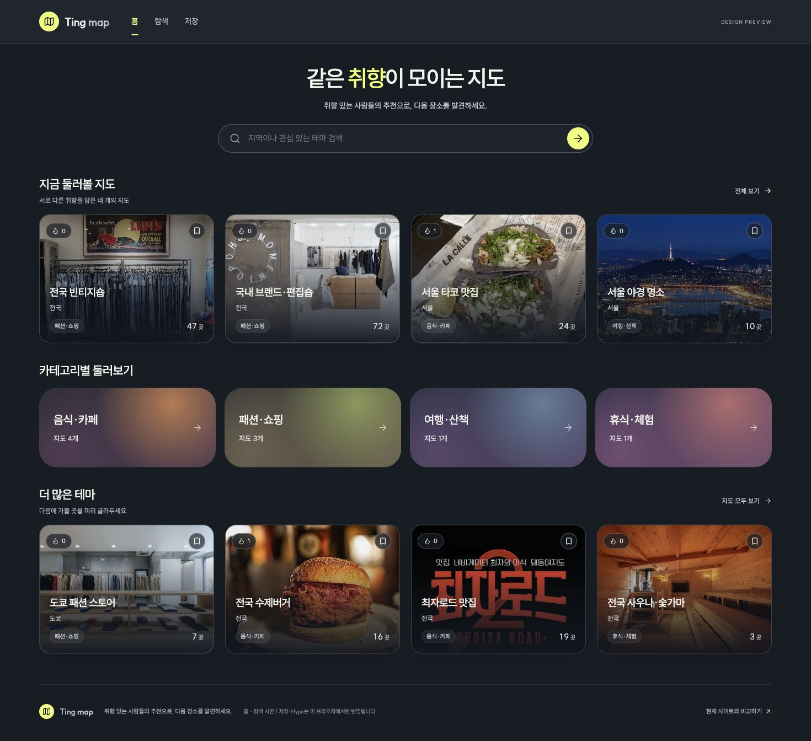
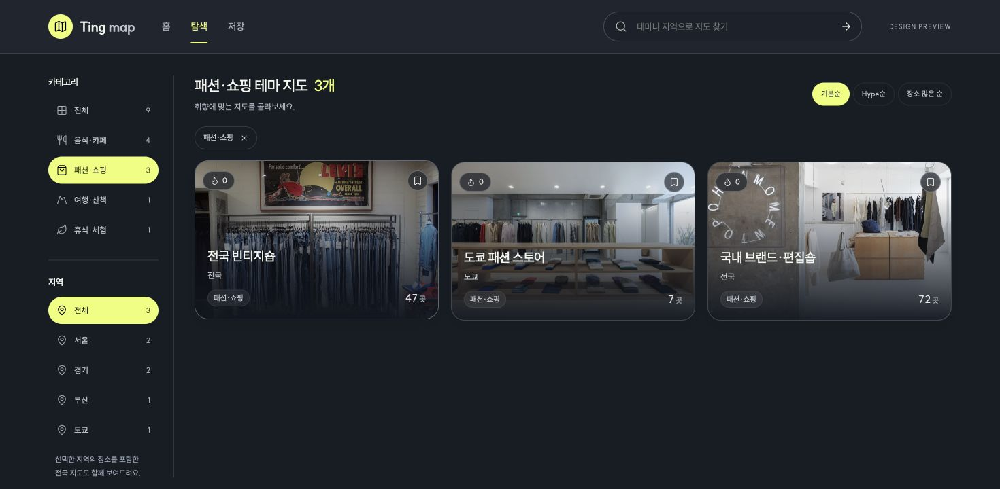

# Existing home vs. HTML prototype — 2026-10-29

## Verdict

At the current nine-map inventory, the separate home/explore prototype does not establish enough distinct value to justify replacing the original unified discovery screen. The strongest prototype contribution is explicit region selection, not the existence of two routes. Recommend a unified map-finding home, preserving existing visual treatment and borrowing URL-backed conditions/direct navigation from the prototype. Editorial content can justify a separate home later, but should not be manufactured solely to fill a route.

## Observed flow

1. Original home — healthy immediate entry: visible search, adjacent category chips, three-column maps and actual popularity/save state. Capture01.
2. Original “패션” selection — healthy category narrowing: one selection updates the same page to three maps. URL remains `/`, so that condition is not shareable/reload-persistent through the URL. Capture02.
3. Prototype home — mixed: intentionally curated four-map row, then category navigation, then four more maps. Only8 of9 maps shown; the category grid starts around703px at1470px width. In the captured720px-tall prototype viewport the category area is mostly below the first screen. Capture03.
4. Prototype fashion explore — healthy filtering UI, weak route differentiation: the category tile opens another screen containing the same three fashion maps as step2. Sticky region selection is a real additional capability. Capture04.

Both category choices take one click; this is not evidence that route separation always adds a click. The original requires opening a preview before its full-map link, whereas the prototype links directly; that independent improvement can also be applied to a unified home.

## Evidence

All screenshots captured and opened in this audit run. Desktop width1470px for both. Original capture height776px; prototype visible viewport720px, full-page home capture used to inspect content below the fold. Compare entry positions and routes, not pixel-perfect artwork or task timing. Prototype map counts/coverage are sample snapshots and its personal state is isolated from the real account.

## Recommendation

- Keep the original centered introduction/search and one complete map list.
- Keep categories close to search; if richer matte category tiles are used, they should replace the chips and filter this same list rather than duplicate a second category navigation section.
- Offer explicit region selection only when useful; search can already accept regional names, but structured selection is more predictable.
- Retain sort and Hype/save feedback, shareable condition URLs, count clarity and direct map entry.
- Avoid fixed four-map recommendation and “more” sections that merely partition the same small inventory. A short editorial pick can be added when it has a concrete reason.
- For a much larger catalog, use pagination/limits and a compact or sticky filter layout on the same screen first. Inventory growth alone does not require separate home/explore routes.
- Separate home when it offers distinct, regularly refreshed value: field reports, themed itineraries, specific editorial selections/reasons, or genuinely useful personalized/resume content. Explore can then remain the full catalog.

## Accessibility and evidence limits

Existing filters expose pressed state; prototype navigation exposes selected state and independently labeled reaction buttons. Screenshots show small metadata in both versions; keyboard-focus movement/live announcements after filtering and zoom/contrast need dedicated checks if either version is implemented. This audit does not certify accessibility compliance.

No usability study, clickstream or timing benchmark was run. Conclusions are structural UX judgments grounded in the captured flow, not measured conversion or speed gains. No existing product or prototype code was changed during this review; only this report and screenshots were added.
